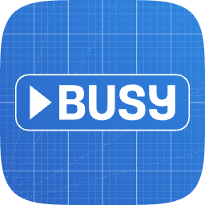
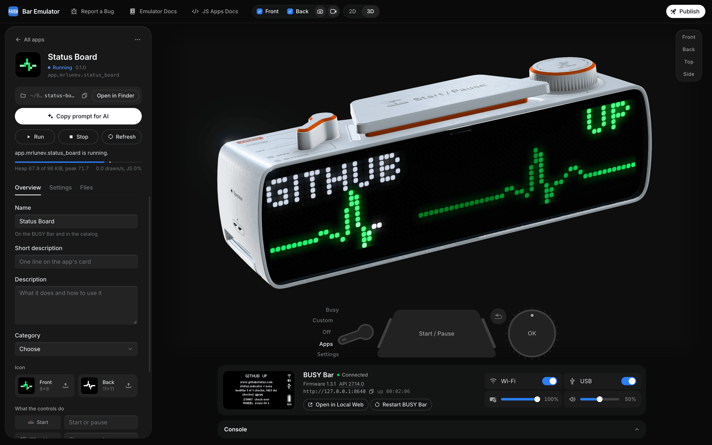

<!--
  DESIGN PLACEHOLDER (banner). The same template as busy-app/busybar-firmware's banner: 1600×400 PNG, a dark and a
  light version; "▶BUSY Bar" logo on the left, "Emulator" in gray beneath it, the emulator's window with the BUSY Bar
  running an app on the right. Files: .github/assets/dark_theme_banner.png and .github/assets/light_theme_banner.png.
  Until they exist, the icon below stands in; when they do, replace the  with this block:

<picture>
    <source media="(prefers-color-scheme: dark)" srcset="/.github/assets/dark_theme_banner.png">
    <source media="(prefers-color-scheme: light)" srcset="/.github/assets/light_theme_banner.png">
    
</picture>
-->

# BUSY Bar Emulator

A BUSY Bar on your computer. Write a JavaScript app, run it, take its screenshots and submit it to the catalog, all
without a BUSY Bar.

- [BUSY Bar Website](https://busy.app) - What a BUSY Bar is and where to get one.
- [Emulator Docs](https://go.busy.app/busy-emulator-docs) - Install the emulator, write your first app and submit it.
- [JS Apps Docs](https://go.busy.app/js-apps) - The JavaScript runtime, the displays and the BUSY Bar's API.
- [Instructions for AI agents](https://go.busy.app/agents) - Give this link to your agent, and it does the rest.
- [BUSY Apps Catalog](https://github.com/busy-app/busy-apps-catalog) - Where your finished app goes.

<!--
  DESIGN PLACEHOLDER (GIF). public-docs/images/emulator-demo.gif: 1200×800, 8 to 12 s loop, under 10 MB, dark
  window. Create app picks a template, the app starts on the BUSY Bar, the wheel turns, Screenshot saves both
  displays. Recorded with `busy-emulator record` from the emulator's window. Until it exists, the still below stays.
-->


# Download

This is a beta release, 0.1.0-beta.1. Get it from [GitHub Releases](https://github.com/busy-app/busybar-emulator/releases/latest):

| System | File | Size |
|---|---|---|
| macOS, Apple Silicon (M1 and later) | [busybar-emulator-mac-arm64.dmg](https://github.com/busy-app/busybar-emulator/releases/latest/download/busybar-emulator-mac-arm64.dmg) | about 210 MB |
| macOS, Intel | [busybar-emulator-mac-x64.dmg](https://github.com/busy-app/busybar-emulator/releases/latest/download/busybar-emulator-mac-x64.dmg) | about 215 MB |
| Windows x64 | [busybar-emulator-win-x64-setup.exe](https://github.com/busy-app/busybar-emulator/releases/latest/download/busybar-emulator-win-x64-setup.exe) | about 250 MB |

macOS needs 13.5 (Ventura) or later. The app installs for your user only, without administrator rights. Node, npm
and the BUSY Bar tools are inside it. [SHA256SUMS](https://github.com/busy-app/busybar-emulator/releases/latest/download/SHA256SUMS)
lists the checksum of each file.

On macOS the app is signed and notarized by Apple, so it opens without a security warning. On Windows the setup is
not signed yet, and SmartScreen warns you the first time you run it.
[Here is what to do](public-docs/install.md#opening-it-for-the-first-time).

**For AI agents:** [install-macos.sh](public-docs/install/install-macos.sh) and
[install-windows.ps1](public-docs/install/install-windows.ps1) download the release, check it against `SHA256SUMS`,
install it for the current user and start it. See [install.md](public-docs/install.md#for-agents-install-and-start-the-emulator).

# Features

- Run the BUSY Bar's own firmware 1.3.1 code, compiled to WebAssembly: the JavaScript runtime, the displays, the
  system screens and the local web
- See both displays and use every control: the mode switch, Start / Pause, Back and the wheel, flat or in 3D
- Run your app at a BUSY Bar's speed, with its memory, `fetch` and API limits
- Install and run apps with the official `busy-cli`, as on a BUSY Bar
- Take screenshots in the catalog's format, 72×16 and 160×80 pixels
- Record an MP4 or a GIF of your app for a post
- Check your project against the BUSY Apps Catalog's rules and publish it, step by step
- Drive it all from `busy-emulator`, the command line for people and agents, or from a chat client over MCP

# Quick start

Open the app. It asks how you want to start:

- **I'll write the code** opens Create app: pick a template, a name and a folder, and your app runs on the BUSY Bar.
- **My AI agent will** gives you a text for your agent. Or paste this into Claude Code, Codex or Cursor:

```text
Make me a BUSY Bar app: <your idea>.
Follow https://go.busy.app/agents. I have no BUSY Bar, so use BUSY Bar Emulator as that page says.
```

From a terminal on macOS:

```sh
cli=~/.busy-emulator/bin/busy-emulator
"$cli" create my-app --author "Your Name"
cd my-app
"$cli" dev          # builds, installs and starts the app again on every save
```

On Windows, in PowerShell:

```powershell
$cli = "$env:LOCALAPPDATA\busy-emulator\bin\busy-emulator.exe"
& $cli create my-app --author "Your Name"
cd my-app
& $cli dev
```

`help` lists every command. The whole way, from the download to the catalog's pull request, is in
[From zero to a catalog submission](public-docs/from-zero-to-catalog.md).

# Contributing

## I need help

Start with the [Emulator Docs](https://go.busy.app/busy-emulator-docs) and [Troubleshooting](public-docs/troubleshooting.md).
For the app itself, see the [JS Apps Docs](https://go.busy.app/js-apps).

## I want to report an issue

Open an [issue](https://github.com/busy-app/busybar-emulator/issues). Include the output of `busy-emulator version`,
your system, and the steps to reproduce it. [What else helps](public-docs/troubleshooting.md#reporting-a-problem).

If your app behaves differently on a BUSY Bar, say so, with the BUSY Bar's firmware version. A BUSY Bar has the final
word: [how the emulator differs from a BUSY Bar](public-docs/differences.md).

## I want to contribute code

This repository is exported from the emulator's development repository, without its history. Pull requests are
welcome; we carry the changes over by hand.

Your own app does not belong here. Publish it in the [BUSY Apps Catalog](https://github.com/busy-app/busy-apps-catalog).

# Development

The emulator is written in JavaScript for Node and Electron. The BUSY Bar's own code is C, from the
[BUSY Bar firmware](https://github.com/busy-app/busybar-firmware), compiled to WebAssembly.

## Requirements

- Node 22 or later to run the emulator from source
- macOS or Windows to build the desktop app

## Running from source

```sh
node packages/server/index.mjs
```

The BUSY Bar's API answers on http://127.0.0.1:8640, and the emulator's window is at http://127.0.0.1:8640/emulator.
From an app's folder:

```sh
npx busy-cli app install --addr 127.0.0.1:8640
npx busy-cli app run --addr 127.0.0.1:8640
```

`node packages/server/index.mjs --help` lists the options.

## Building the desktop app

```sh
cd packages/app
npm ci
npm run dist
```

## Testing

```sh
npm run gate
```

It runs every test, including the comparison with recordings of a BUSY Bar, and ends with exit code 0 only when all is
green.

## Documentation

- [Installing BUSY Bar Emulator](public-docs/install.md) - What is downloaded from where, the first open, removing it
- [Your first app](public-docs/first-app.md) - Create, build, run, screenshot and submit
- [BUSY Bar Emulator in a chat client](public-docs/mcp.md) - The emulator's tools over MCP
- [Network and disk](public-docs/network-and-disk.md) - What the emulator does on your network and disk
- [Differences from a BUSY Bar](public-docs/differences.md) - Where the emulator is stricter, and why
- [Building from source](public-docs/build-from-source.md) - What each system needs, and rebuilding the WebAssembly
- [Changelog](CHANGELOG.md)

# Project structure

- `packages/server` - The BUSY Bar's HTTP API, the emulator's window and the `busy-emulator` command line
- `packages/engine` - The firmware's code compiled to WebAssembly, its stubs and its build script
- `packages/app` - The Electron desktop app
- `packages/stage` - The 3D view of the BUSY Bar
- `packages/contract` - Schemas of the emulator's operations and events
- `examples` - Example apps to start a project from
- `test` - Comparison with recordings of a BUSY Bar, and end-to-end tests
- `public-docs` - Documentation

# License

Copyright (C) 2026 Flipper FZCO. BUSY Bar Emulator is free software under [GPL-2.0-or-later](LICENSE). It is built
from the open [BUSY Bar firmware](https://github.com/busy-app/busybar-firmware) and holds its code and assets, each
part under its own license: [THIRD_PARTY_NOTICES.md](THIRD_PARTY_NOTICES.md).

Two parts of the 3D view are not under the emulator's license. The Tride web player 0.16.0
(`packages/stage/frame/player/`) is under the Tride Players Licence 1.2 of Tride Labs Ltd, in the `LICENSE` beside it;
get the player from [trideapp/tride-web](https://github.com/trideapp/tride-web), not from here. The model of the BUSY
Bar (`packages/stage/frame/scene/bar.trd`) is © Flipper FZCO, all rights reserved, and ships only for the emulator's
own 3D view.

# Links

- Website: [busy.app](https://busy.app)
- Emulator Docs: [go.busy.app/busy-emulator-docs](https://go.busy.app/busy-emulator-docs)
- JS Apps Docs: [go.busy.app/js-apps](https://go.busy.app/js-apps)
- For AI agents: [go.busy.app/agents](https://go.busy.app/agents)
- BUSY Apps Catalog: [busy-app/busy-apps-catalog](https://github.com/busy-app/busy-apps-catalog)
- BUSY Bar firmware: [busy-app/busybar-firmware](https://github.com/busy-app/busybar-firmware)
