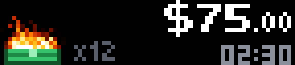
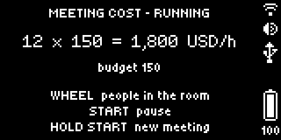
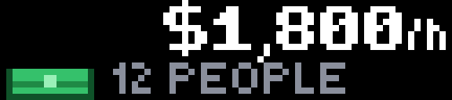
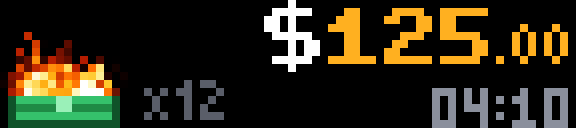
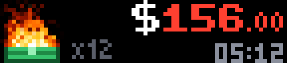
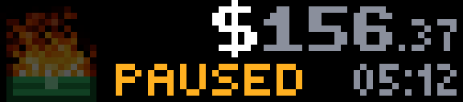

# Meeting Cost

What this meeting has cost so far. A stack of money burns on the left, and the amount on the right goes up every
second: people in the room × what an hour of each costs. Past the budget the fire grows and the number turns red. An
example app for the BUSY Bar, made to start from: `busy-emulator create my-app --example meeting-cost`.



The front display (72×16, color) faces the room: the fire, the amount, how many people, how long.



The back display (160×80, gray) faces you: what the number is made of, and what each control does now.

| Before the meeting | Near the budget | Over the budget | Paused |
| --- | --- | --- | --- |
|  |  |  |  |

## Controls

| Control | What it does |
| --- | --- |
| Wheel | People in the meeting, also while it runs: someone joined or left. What is spent stays spent |
| Start (or a press of the wheel) | Begins the meeting; pauses it and goes on |
| Start, held | A new meeting: back to zero |
| Back | Leaves the app |

## Settings

On the BUSY Bar's web page, under Apps → Meeting Cost. The app reads them when it starts; after saving, the page offers
Restart.

| Setting | What it changes |
| --- | --- |
| People in the meeting | The headcount the meeting starts with (1–99) |
| Hourly rate per person | What an hour of one person costs |
| Currency | The sign before the amount: dollar, euro, pound, yen, or none |
| Budget | Amber from three quarters of it, red past it, with a bigger fire and a blink of the BUSY Bar's light; 0 turns it off |
| Flare on every | The fire flares up each time the amount passes a round sum: 10, 50, 100, 500, 1000, or never |
| Sound past the budget | A sound, once, when the meeting passes its budget |
| Start counting at once | The meeting starts when the app opens |

## How it is made

Things here that are worth copying into your own app:

- **The fire is the firmware's work.** A BUSY Bar draws a whole frame from JavaScript about 3.5 times a second. The fire is
  one `.anim` file with three sections: `calm` and `hot` loop, `flare` plays once, and the steady fire is queued
  behind a flare with `await_previous_end`, so the flare is not cut short.
- **A tick costs two small text elements.** `shared/screen.ts` sends only the elements whose description changed; the
  fire, the sign and the headcount are not sent again when the cents move.
- **The meeting's time counts up by itself**: a `countdown` element with `direction: "time_since"`.
- **The BUSY Bar's fonts are ASCII.** There is no € or £ in them, so the currency signs are small pictures
  (`src/images/sign_*.png`), and their place is worked out from the widths of the digits, written down in
  `src/main.ts`: the BUSY Bar has no call that measures a text.
- **Settings are read with the BUSY Bar's HTTP API**, `shared/settings.ts`. The template's own `loadValues()` reads a
  global that firmware 1.3.1 does not have.
- **A timer that was never set is not cleared**: `clearInterval(undefined)` makes the firmware log a warning.
- It runs in a 96 KiB heap (`heap_size_kib` in the manifest); it peaks near 73.

## Build and run

```sh
busy-emulator build                    # dist/<app id>.tgz
busy-emulator run                      # installs it on the emulated BUSY Bar and starts it
busy-emulator logs                     # what the app printed, and why it ended if it did
busy-emulator screenshot --scale 8     # screenshots/front-1.png, and an enlarged copy to look at
```

`busy-emulator dev` does the first two again on every save. On a BUSY Bar connected over USB the same project builds and
installs with `npm run build`, `npm run app:install` and `npm run app:run`.

The pictures in `docs/` show this example; the screenshots of your own app go to `screenshots/`, where the catalog's
checks look for them (`busy-emulator check`).

The pictures and the animation are drawn by code: `examples/tools/make-art.py` in the emulator's repository.
