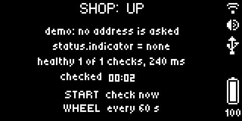

# Status Board

Is it up? The BUSY Bar asks an address every minute and shows the answer as a heartbeat: a green pulse while it is
healthy, amber and slow when the answer took long, a red flat line with the reason when it is down. An example app for
the BUSY Bar, made to start from: `busy-emulator create my-app --example status-board`.


The front display (72×16, color) faces the room: the name, the status word, the pulse.



The back display (160×80, gray) faces you: what was asked, what came back, and what each control does.

| Slow | Down |
| --- | --- |
|  |  |

Out of the box it watches GitHub's public status page (`status.indicator` is `none` when all is well). Set the
address to `demo` to see every state in turn without a network.

## What it says when it is not well

| Word | What happened |
| --- | --- |
| the field's value, such as `MAJOR` | The address answered, and the field is not one of the healthy values |
| `HTTP 503` | The address answered with an error status |
| `TIMEOUT` | No data for 5 seconds: the BUSY Bar's `fetch` gives up then |
| `NO WIFI` | The request failed and the BUSY Bar is not on Wi-Fi |
| `NO ANSWER` | The server could not be reached, or the TLS connection failed |
| `BAD JSON`, `NO FIELD` | The answer is not JSON, or has no such field |
| `TOO BIG` | The answer is over 8 KiB and is not read: the app's whole heap is 96 KiB |

The back display has the detail in the BUSY Bar's own words, and the app's log has a line for each change.

## Controls

| Control | What it does |
| --- | --- |
| Start (or a press of the wheel) | Checks now |
| Wheel | Time between checks, 5 seconds to an hour |
| Back | Leaves the app |

## Settings

On the BUSY Bar's web page, under Apps → Status Board. The app reads them when it starts; after saving, the page offers
Restart.

| Setting | What it changes |
| --- | --- |
| Address to check | An http or https address; `demo` shows every state without asking anything |
| Name on BUSY Bar | Up to 8 letters beside the status word |
| Status field | A path into the answer, such as `status.indicator` or `checks.0.state`; empty: only the HTTP status counts |
| Values that mean healthy | Comma-separated; any other value of the field is down and becomes the status word |
| Seconds between checks | Where the wheel starts |
| Slow above, ms | A healthy answer slower than this turns the pulse amber; 0 turns this off |
| Request header | Optional `Name: value`, for an address that wants a token; masked on the page |
| Sound when down | A sound, once, when a healthy address stops being healthy |

## How it is made

Things here that are worth copying into your own app:

- **`fetch` on a BUSY Bar is not a browser's.** It gives up after 5 seconds without data, it rejects with a plain string
  ("Inactivity timeout", "Failed to connect to server"), not an `Error`, and there is no way to cancel it. `check()`
  in `src/main.ts` turns every way a request can end into a result the screen shows; nothing is thrown.
- **One request at a time**: the next check is scheduled only when this one has ended.
- **Read small.** The app's whole heap is 96 KiB, and a heap overflow restarts a BUSY Bar. An answer that says it is larger
  than 8 KiB is not read at all. Ask for the smallest document that has what you need.
- **Text on the BUSY Bar is printable ASCII**: whatever came from the network is cleaned before it is drawn, or the BUSY Bar
  refuses the whole draw request.
- **The pulse is the firmware's work**: one `.anim` file with a section per state (`up`, `slow`, `down`, `wait`),
  played 25 times a second; the app names the section.
- **"Checked … ago" counts up by itself** on the back display: a `countdown` element with `direction: "time_since"`.
- **The BUSY Bar's light blinks on a change**, down or back up, not on every check (`led_notification_color`).
- **Settings are read with the BUSY Bar's HTTP API**, `shared/settings.ts`. The template's own `loadValues()` reads a
  global that firmware 1.3.1 does not have.
- **In the emulator an app cannot reach this computer's own services** unless you allow the port:
  `busy-emulator allow-local 3000`.

## Build and run

```sh
busy-emulator build                    # dist/<app id>.tgz
busy-emulator run                      # installs it on the emulated BUSY Bar and starts it
busy-emulator logs                     # what the app printed, and why it ended if it did
busy-emulator screenshot --scale 8     # screenshots/front-1.png, and an enlarged copy to look at
```

`busy-emulator dev` does the first two again on every save. On a BUSY Bar connected over USB the same project builds and
installs with `npm run build`, `npm run app:install` and `npm run app:run`.

The pictures in `docs/` show this example; the screenshots of your own app go to `screenshots/`, where the catalog's
checks look for them (`busy-emulator check`).

The animation is drawn by code: `examples/tools/make-art.py` in the emulator's repository.
