# From zero to a catalog submission

This page takes you from a computer without the emulator to a pull request in the BUSY Apps Catalog, with a
screenshot and a clip for your post on the way. There are two paths. You can do every step yourself in the
emulator's window, or have an AI agent do most of them while you make the choices that are yours. You can also mix
them: an agent writes the app, and you publish it in the window.

<!-- Screenshots: the window's own are taken by packages/app/test/app/guide-shots.test.mjs (GUIDE_SHOTS=<folder>). The list is at the end of this page. -->

## The two paths side by side

| Step | By hand, in the window | With an AI agent |
|---|---|---|
| Install | You download and open the app | The agent can install it; it asks you first |
| Create the app | **Create app** | The agent runs `create`, or you press **Create the project folder first** |
| Write the code | You edit `src/main.ts` in your editor | The agent writes it |
| Run it | **Run** in the app's column (**Refresh** while it runs) | The agent runs `dev --once` |
| Screenshots | **Screenshot** over the BUSY Bar | The agent takes them and looks at them |
| A clip for your post | `record` on the command line | The agent runs `record` |
| Prepare for the catalog | **Publish**, seven steps | The agent does them; you choose the license |
| Publish to GitHub | You sign in and press **Publish to GitHub** | You sign in and confirm in the emulator's dialog |
| Send to catalog | You tick the checklist and press **Send to catalog** | You choose the AI usage, tick the checklist and confirm |

## Before you start

- A Mac with macOS 13.5 or later (Apple Silicon or Intel), or a Windows 10 or 11 PC (x64).
- A GitHub account. The catalog takes an app as a pull request on GitHub, and your app's code goes into a public
  repository of yours. You do not need git or GitHub CLI of your own: GitHub CLI is inside the emulator.
- About 1.5 GB free on the disk while it installs, and the internet for the download and for each new project.
- For the second path: an AI agent that runs commands on your computer, such as Claude Code, Codex or Cursor. A chat
  client that cannot run commands, such as Claude Desktop, uses the emulator's MCP tools instead:
  [BUSY Bar Emulator in a chat client](mcp.md).

No BUSY Bar is needed. If you have one, run your app on it too before you send it: the BUSY Bar has the final word
([how the emulator differs from a BUSY Bar](differences.md)).

## 1. Install and open the emulator

Download the file for your system from [the download table](README.md#busy-bar-emulator). On macOS the app is
signed and notarized by Apple; the Windows setup is not signed yet, so Windows warns you once, the first time.

**macOS.** Open the `.dmg` and drag BUSY Bar Emulator to Applications. Open it from Applications, not from the disk
image. The first time, macOS asks whether to open an app downloaded from the internet: choose **Open**.

**Windows.** Run `busybar-emulator-win-x64-setup.exe`. SmartScreen says "Windows protected your PC": choose **More
info**, check that the file is `busybar-emulator-win-x64-setup.exe`, then **Run anyway**. The setup needs no
administrator rights. Open BUSY Bar Emulator from the Start menu.

After that the app opens like any other. Every step in detail: [Opening it for the first time](install.md#opening-it-for-the-first-time).

The first time it opens, the window asks **How will you make your app?** **I'll write the code** is the first path
below, **My AI agent will** the second. "Getting started", at the foot of the Apps list, brings the question back.

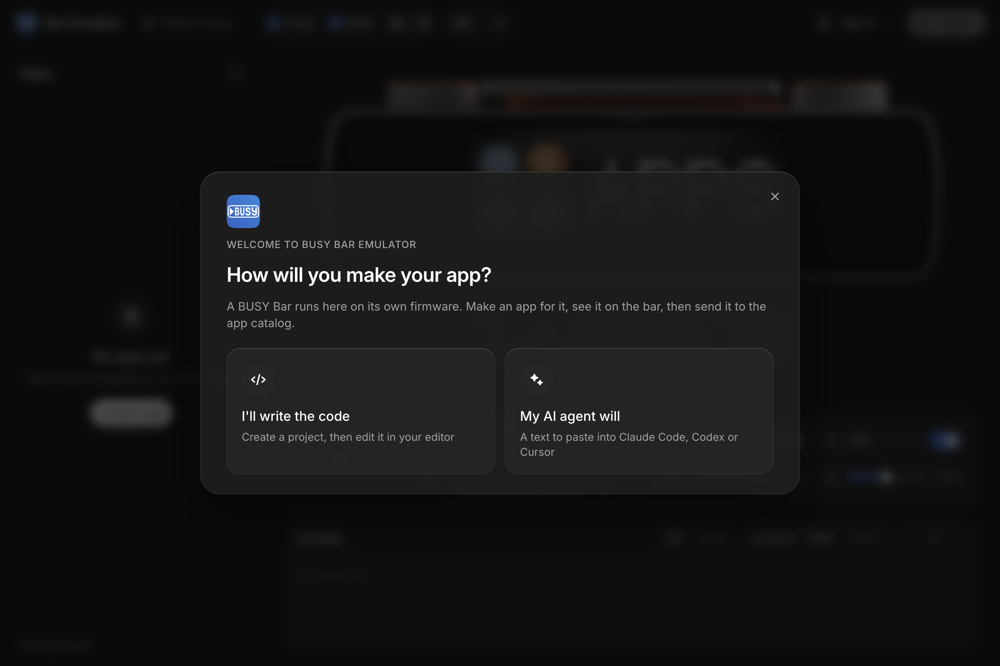

## 2. By hand, in the window

### Create the app

Press **Create app** at the top of the Apps list (or File → New App…). The dialog has five tabs:

- **Templates**: the official template, or one of three finished examples (Focus Timer, Meeting Cost, Status Board).
  Choose one, give the app a name, and check Location, the folder the project goes in.
- **Empty app**: the name, a short description, the category and an icon: letters made from the name, one of the
  drawn icons, or **Upload icon** for your own PNG of 8×8 pixels (and 11×11 for the back, if you like).
- **Open existing**: a project you already have. Choose its folder or any file in it. The emulator asks you once
  whether you trust the folder, because building a project runs its code.
- **Import from GitHub**: a repository on github.com. Sign in as in [Publish to GitHub](#publish-to-github), paste
  the repository's address, check Location and press **Import**. The emulator downloads it and asks whether you
  trust the folder, as for Open existing.
- **Install a package**: an app package (`.tgz`) someone built. The emulator shows the app's name, id and version
  and installs it only when you choose Install. It is listed in Apps with no project folder.

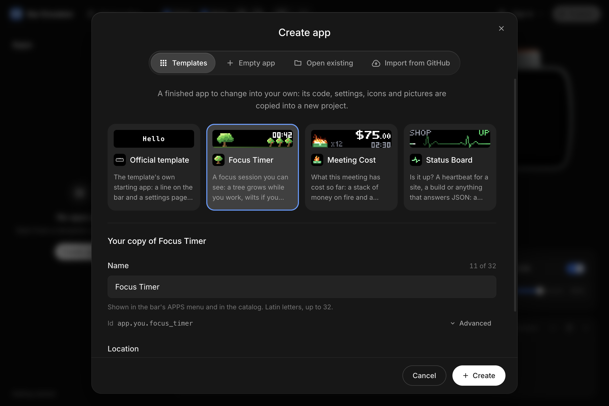

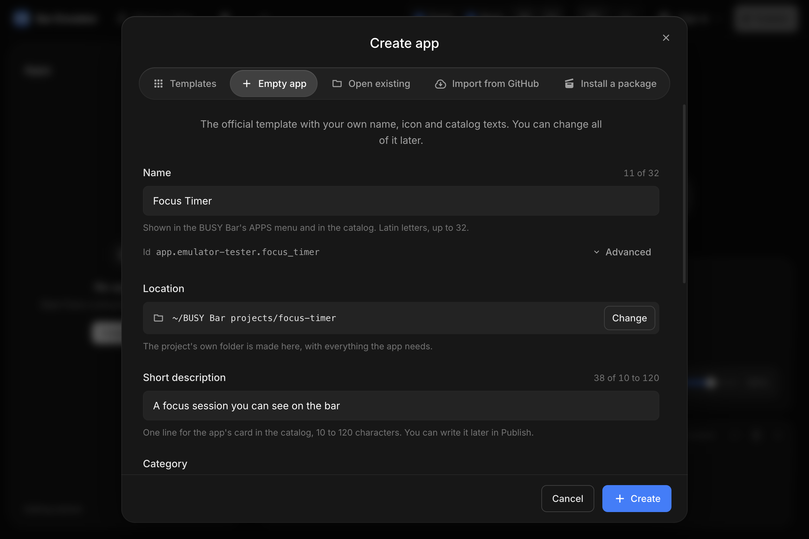

Press **Create**. The emulator makes the project, builds it, puts it on the BUSY Bar and starts it. The first project
downloads the template and its packages from the npm registry, which can take a minute.

### Write the code and run it

The app's code is `src/main.ts` in the project's folder. The folder's path is at the top of the app's column, with
Copy and **Open in Finder** (Show in Explorer on Windows) beside it; open the folder in your editor. What the BUSY Bar
can do is in the project's `AGENTS.md` and `types/`. To work with an AI agent, press **Copy prompt for AI** and paste
the text into the agent: it holds the app's folder and the emulator's commands.

After a change, press **Run** in the app's column (**Refresh** while the app runs). It builds the app, installs it on
the BUSY Bar and starts it, the same as `dev --once`. The
**Console** shows what the app prints with `console.log`, and its errors. A build that fails leaves
the previous version on the BUSY Bar.

Use the BUSY Bar's controls in the window as on a BUSY Bar: Start, Back and the wheel (turn it, or click it for OK). The app's
settings page is the app's **Settings** tab, and **Open in Local Web** at its end: the BUSY Bar has no keyboard, so its
settings live on the BUSY Bar's web page. The **Catalog** tab shows what Publish asks for and how much of it is ready;
**Files** lists what goes to the app's public repository.

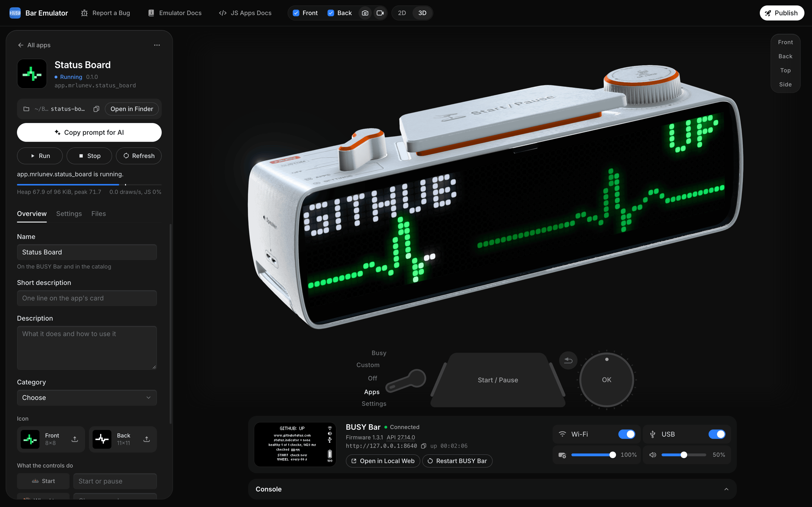

### Take screenshots

Run the app to its best screen. Press **Screenshot** over the BUSY Bar, with Front, Back or both ticked (Cmd+Shift+S,
Ctrl+Shift+S on Windows). The files go into `screenshots/` of the project: 72×16 for the front, 160×80 for the
back, the size the catalog takes. The first front screenshot is the app's cover in the catalog.

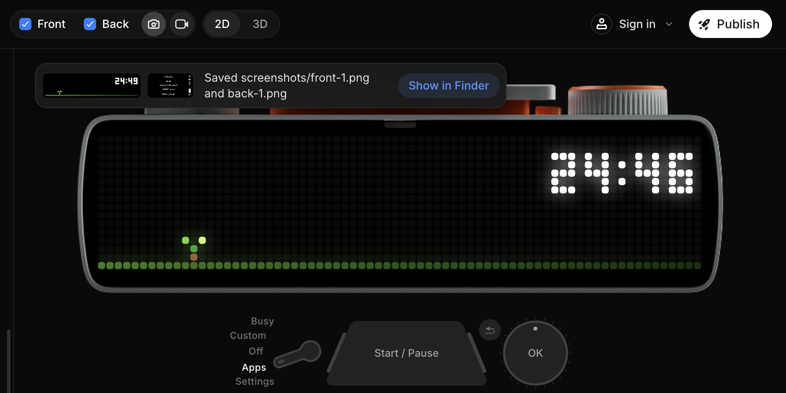

### Make a clip for your post

Press **Record** in the window's top bar, beside the camera, and choose what to record: **Window**, the window as you
see it; **Post, 1080×1920**, the BUSY Bar upright for Reels, TikTok and X; or **Front display**, the front display
alone. The button turns red and counts the time. Press it again to stop, then choose where the MP4 goes. A recording
stops by itself after 2 minutes.

The command line makes the same clips, and a GIF of the front display. Open a terminal in the project's folder. On
macOS:

```sh
~/.busy-emulator/bin/busy-emulator record --seconds 10                # media/clip-1.mp4 of the window, as you see it
~/.busy-emulator/bin/busy-emulator record --layout post               # 1080×1920, the BUSY Bar alone, for a vertical post
~/.busy-emulator/bin/busy-emulator record --gif                       # media/clip-1.gif of the front display
```

On Windows, in PowerShell:

```powershell
& "$env:LOCALAPPDATA\busy-emulator\bin\busy-emulator.exe" record --seconds 10
```

The clip goes into the project's `media/`. While the default clip records, use the BUSY Bar's controls in the window: the
clip shows it. More: [a clip for your post](first-app.md#a-clip-for-your-post).

### Prepare it for the catalog

Press **Publish** over the BUSY Bar (or **Publish…** in the app's **…** menu). The dialog shows the steps on the left. In
the first stage, Prepare, nothing leaves your computer. **Next** saves the step and is off, with the reason beside
it, until the step is complete. Done steps are ticked, and you can open them again. Close the dialog at any time:
it opens at the first step not done.

1. **Application Info.** The app's icon, its name, the category, the short description (one line on the app's card),
   the description and what's new. The catalog's limits are checked as you type.
2. **Screenshots.** The ones you took, in the catalog's order. **Take from the BUSY Bar** takes one now; **Upload…** adds
   PNG files you made (72×16 or 160×80, or an exact enlargement). Reorder them, or remove one. The first front one is
   the cover.
3. **README.** The front page of your repository. Write a title and a paragraph about the app. Under **How to use**,
   add a row for each control the app uses (Start, Wheel turn, Wheel press, Back), each with a short sentence on what
   it does. The step needs at least one row. Or write the whole README in Markdown. The screenshots, the settings,
   how to build and the license line are added for you.
4. **License.** The catalog takes open source apps only. Choose MIT, Apache 2.0 or GPL 3.0, each said in plain words,
   and write the copyright holder: your name, or your organisation's. Or choose **Upload license file…** for a
   license of your own. The emulator never chooses for you.
5. **Repository files.** What goes into the public repository. Untick a file to keep it out. Anything that looks like
   a secret or personal data is marked: keep it out, or choose Publish it anyway if it is meant to be there.
6. **Pre-flight check.** Builds the app and checks its types, then runs the catalog's checks, all at once. Each
   problem names its step, with **Go to**, or the file and line, with **Open**. Change a file after the check and the
   window says "Changed since the check" and checks again before you go on: only what was checked and packaged goes
   to GitHub.
7. **Build and package.** Builds the app and writes the catalog's entry, `applications/<app id>/manifest.yml`, in
   `submission/` of the project. "Ready to publish" says what will be sent: your source files to GitHub, one file
   to the catalog.

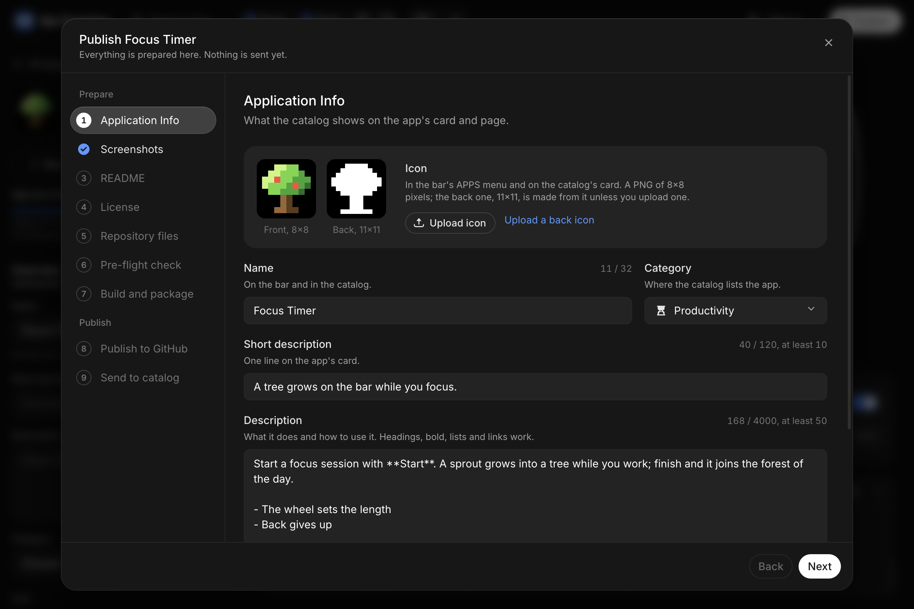

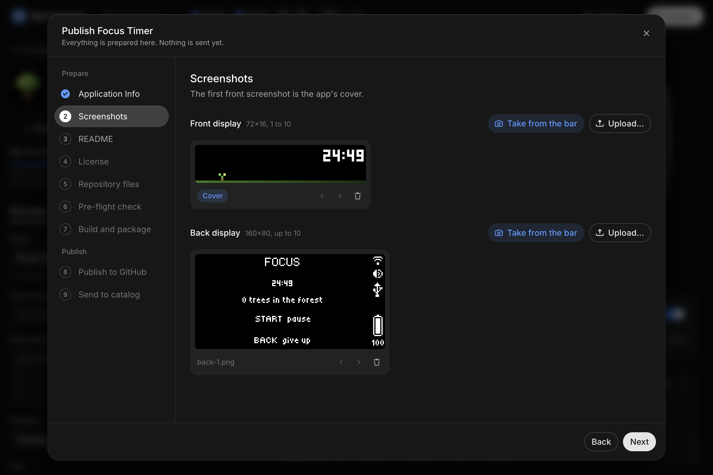

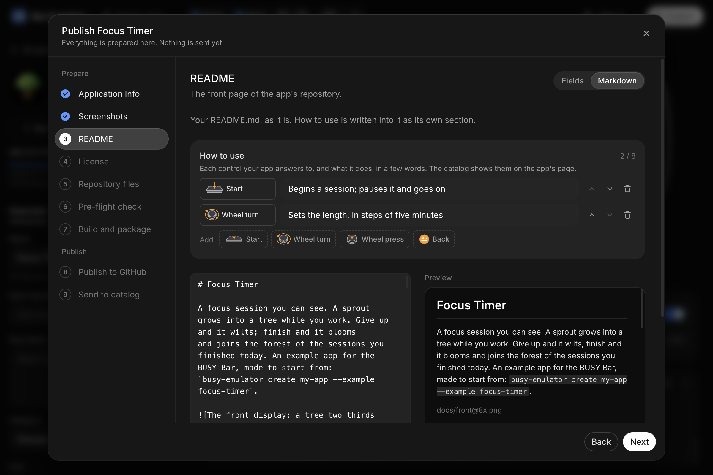

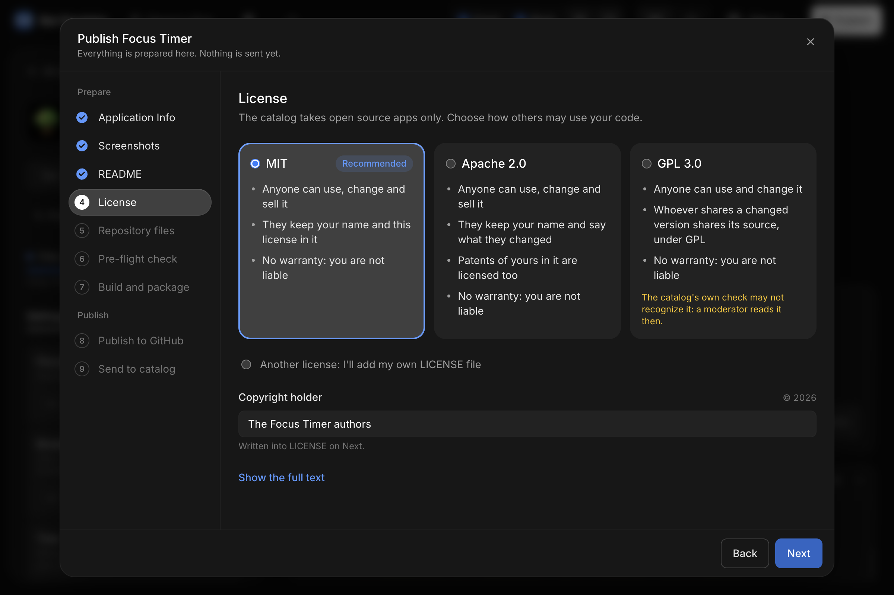

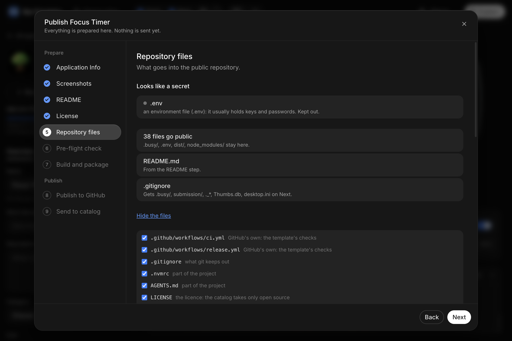

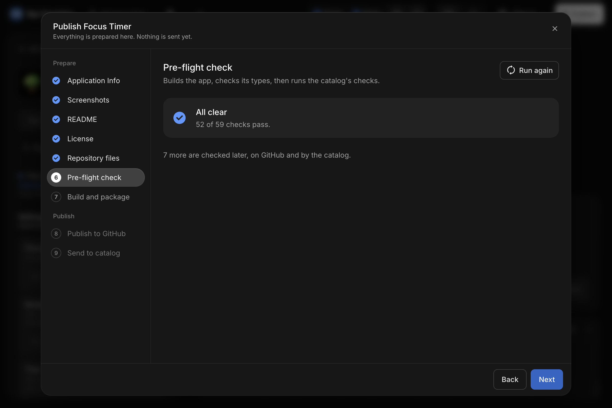

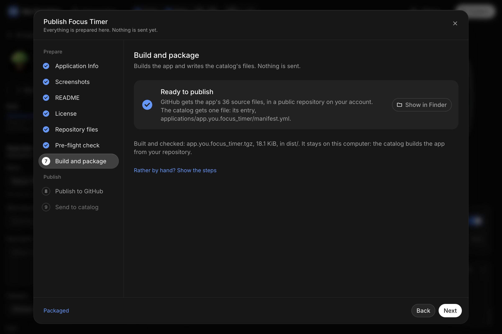

The project keeps what you did in `.busy/publish.json`, which stays out of git. Every step in detail:
[Publishing, step by step](first-app.md#publishing-step-by-step).

### Publish to GitHub

The second stage, Publish, starts with **Publish to GitHub**. First, the account:

- If GitHub CLI on this computer is signed in already, its accounts are listed. Choose the one to publish with.
- Otherwise, or with **Sign in with another account**, the window shows a code. Choose **Open
  github.com/login/device**, enter the code there and authorize **GitHub CLI**. The code is on the clipboard too.

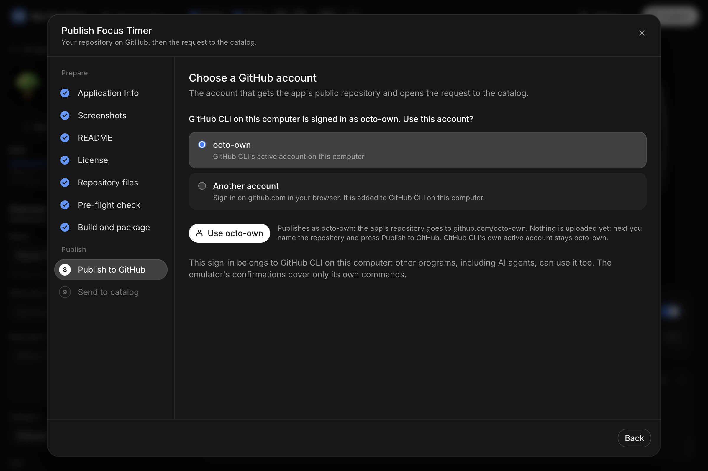

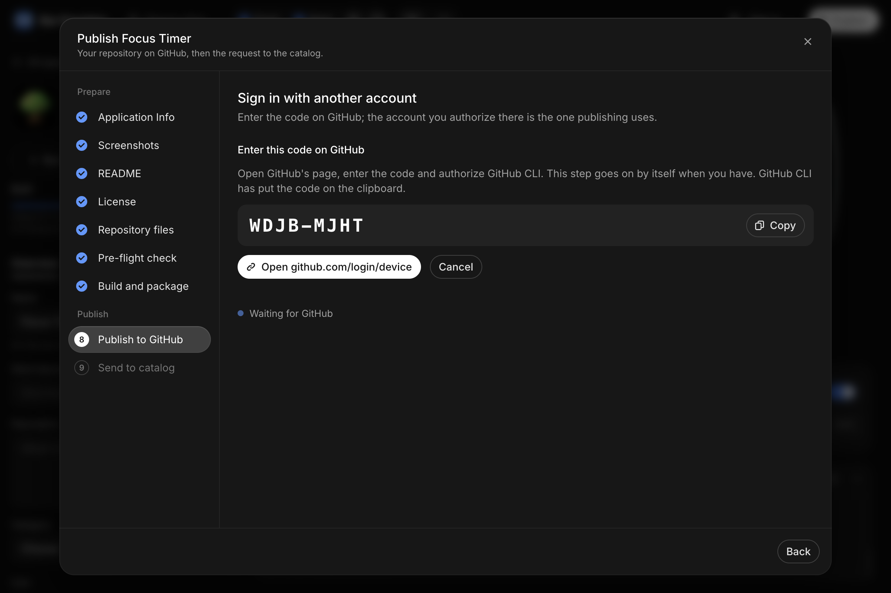

GitHub asks for access to your repositories, your organizations' membership and your gists: that is what GitHub CLI
always asks for. The emulator uses it to make one public repository and the pull request. Neither the emulator nor
GitHub CLI sees your password, and the token stays in your system's password store.

Then check the **Repository** name (the app's name unless you change it) and press **Publish to GitHub**. A BUSY Bar shows
the upload; Cancel stops it before anything changes on GitHub. When it is done, the window shows the repository's
link and its commit. Publishing again later updates the same repository.

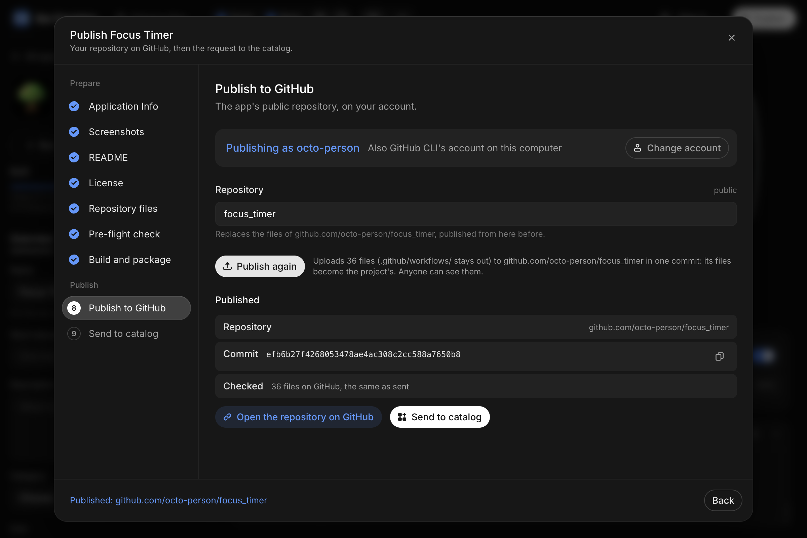

### Send to catalog

Press **Send to catalog**. The step shows the catalog's own pull request checklist, as the catalog's template has it:

- I've read the [terms for authors](https://github.com/busy-app/busy-apps-catalog/blob/main/TERMS.md) and my app
  follows them
- I'm the author of the app or have write access to its repository
- The app builds with `busy-cli build`, and the lock file is committed
- The manifest follows the catalog manifest format
- I've tested the app on a BUSY Bar with the latest release firmware
- The screenshots are taken from the bar
- (optional) My app takes part in the BUSY JS Apps Contest, and I accept the
  [contest rules](https://go.busy.app/terms-of-js-apps-contest)

The list on your screen is read from the catalog when the step opens, so it can differ from this one. Read each item
and tick it if it is true: every box you tick goes into the request ticked. **Send to catalog** stays off until every
item is ticked, except one marked optional; tick the contest item only if you enter the contest.

Then choose how AI was used: **No AI was used**, **Partly AI-assisted** or **Fully AI-generated**. The request keeps
that one line. Press **Send to catalog**. The window shows the pull request's link. The catalog's checks run on
GitHub; then a moderator reviews the app.

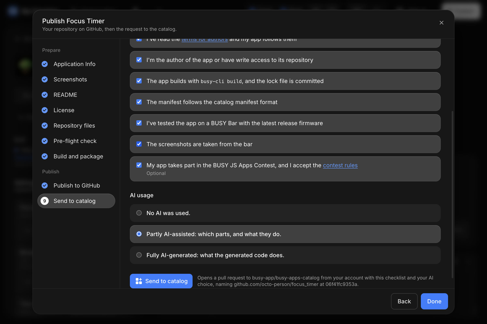

If an item is not true for you, for example you have no BUSY Bar, do not tick it. Send the request by hand instead
([Sending it by hand](first-app.md#sending-it-by-hand)), and say in it what you could not tick and why. The text the
emulator prepares in `submission/PR-DESCRIPTION.md` already says that the app was run on the emulator and not on a
BUSY Bar.

<!-- Update this paragraph when the catalog's checklist changes for authors without a BUSY Bar (EMU-175). -->

Send to catalog sends the request to the BUSY Apps Catalog, https://github.com/busy-app/busy-apps-catalog; the step
names it.

## 3. With an AI agent

### What to tell it

On the first-run question choose **My AI agent will** (or open "Getting started" later). The window shows a text
with the command line's path on your computer. Press **Copy**, paste it into your agent and add your idea at the
end. **Create the project folder first** makes the project in a folder you choose, and the text then names it.

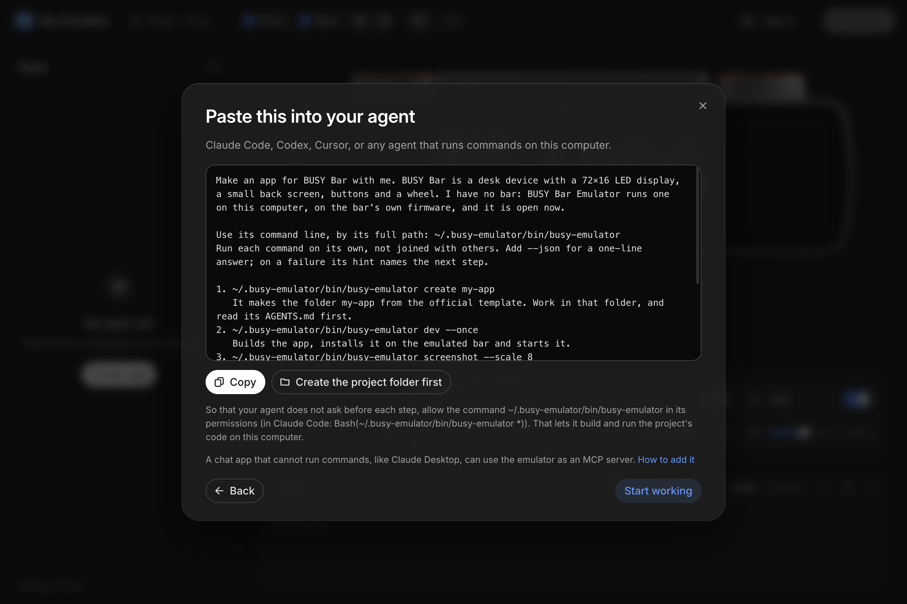

Without the window, two lines are enough. The agent installs the emulator if it is missing:

```text
Make me a BUSY Bar app: <your idea>.
Follow https://go.busy.app/agents. I have no BUSY Bar, so use BUSY Bar Emulator as that page says.
```

When the app is as you want it, ask for the rest:

```text
Get it ready for the BUSY Apps Catalog and send it. Ask me for everything only I can decide.
```

Allow the agent to run the `busy-emulator` command line, or it asks before each step. That lets it build and run the
project's code on your computer. The window shows the rule for Claude Code under the text. In an agent that runs
commands in a sandbox, the command must run outside it (`blocked_network` otherwise:
[Troubleshooting](troubleshooting.md#blocked_network-or-blocked_file)).

### What the agent does alone

- Installs the emulator, after it asks you, and starts it.
- Makes the project, writes the app, builds it and runs it on the emulated BUSY Bar.
- Takes screenshots and looks at them, reads the app's console, presses the buttons, lets time pass for a timer,
  and fixes what it finds.
- Makes the icons, writes the catalog's texts and the README with How to use, takes the catalog's screenshots.
- Writes `.gitignore`, runs the catalog's checks and builds the package.
- Makes a clip for your post with `record`.

You can watch all of it in the window: the BUSY Bar shows the app, the Console shows its output.

### What only you do

The emulator asks you in its own window, or the agent asks you in chat and passes your answer on. No option of the
command line gives these answers for you.

| Your step | Where you answer |
|---|---|
| Trust a folder the emulator did not make (a clone, a copy, a project made with `npm create`) | The emulator's dialog: **Trust** or **Don't Trust**. The agent runs `trust`; you click |
| Choose the license and the copyright holder | In chat. The agent writes the license you chose |
| Sign in to GitHub and choose the account | The emulator's dialog: **Use** with the account's name, or a code you enter on github.com/login/device |
| Confirm the upload to a new public repository | The emulator's dialog: **Publish** or **Cancel** |
| Choose how AI was used | In chat: none, partly or full |
| Tick the catalog's checklist and confirm the request | The emulator's dialog: tick, then **Continue** (or **Send**) or **Cancel** |
| Tick an optional item, such as the contest | Its own dialog after the checklist: tick it or leave it |

The dialogs come to the front of the emulator's window, and a yes in the first second is not taken, so a stray key
press does not answer them. If you choose Cancel, nothing is sent, and the agent should not ask again unless you say
so. Read each dialog: it names the folder, the repository and the catalog.

The sign-in belongs to GitHub CLI on this computer, so other programs, including your agent, can use it too. The
emulator's dialogs cover only its own commands. To take the access back, see
[Publish to GitHub](troubleshooting.md#publish-to-github-github-cli-asks-for-access-to-your-repositories).

### How it ends

The agent's last answer has the pull request's link. Open it: the catalog's checks run there, then a moderator reviews
the app. The optional items you ticked in the dialogs, such as the BUSY JS Apps Contest's, are ticked in it too.
**Publish** in the window shows where every step stands, each done step ticked. The agent reads the same from the
command line:

```sh
~/.busy-emulator/bin/busy-emulator publish status
```

## 4. After you send

- **A change after the request.** Change the app, then publish again: **Publish to GitHub** updates the same
  repository, and **Send to catalog** updates the open request for the same version. The catalog builds exactly the
  commit the request names.
- **A new version.** Raise `version` in `src/appmeta/manifest.json`, write what's new in Application Info, then build
  and package, publish and send again. A new version opens a new request.
- **Your post.** The clip is in `media/` of the project, the screenshots in `screenshots/`. Add the enlarged copies
  (`front-1@8x.png`) to a post; the catalog takes only the small ones.
- **Something went wrong.** Every answer of the command line says what to do next. The codes, and what the window
  says, are in [Troubleshooting](troubleshooting.md).

## Screenshots to take

The window's own pictures come from `packages/app/test/app/guide-shots.test.mjs`: run it with
`GUIDE_SHOTS=<folder>`, then optimise the PNGs losslessly and copy them into `public-docs/images/`. It takes a window
of 1200×800 with an app made from the Focus Timer example, in a home of a user named "you", and the stand-ins for
GitHub CLI and GitHub (accounts octo-person and octo-own). The guide has no pictures of the system's own windows
(macOS's Privacy & Security, Windows SmartScreen) or of the emulator's message boxes (the trust and publish dialogs):
the test cannot take them. Each picture is a PNG in `public-docs/images/` under the name below.

| File | What it shows |
|---|---|
| `guide-welcome.png` | The first-run question: I'll write the code, My AI agent will |
| `guide-create-app-templates.png` | Create app, Templates tab, the official template and the three examples |
| `guide-create-app-empty.png` | Create app, Empty app tab, with a name, a category and a letter icon filled in |
| `guide-window-app-running.png` | The whole window in 3D with Status Board running: the BUSY Bar, its controls, the app's column on its Catalog tab, the BUSY Bar card |
| `guide-screenshot.png` | The Screenshot control over the BUSY Bar, Front and Back ticked |
| `guide-publish-app-info.png` | Publish, Application Info, filled in |
| `guide-publish-screenshots.png` | Publish, Screenshots, with a front and a back screenshot |
| `guide-publish-readme.png` | Publish, README, with two How to use rows and the preview |
| `guide-publish-license.png` | Publish, License, MIT chosen, the copyright holder filled in |
| `guide-publish-files.png` | Publish, Repository files, the list open, one file marked as looking like a secret |
| `guide-publish-check.png` | Publish, Pre-flight check, all clear |
| `guide-publish-package.png` | Publish, Build and package, Ready to publish |
| `guide-publish-account.png` | Publish to GitHub, Choose a GitHub account, with one account listed |
| `guide-publish-code.png` | Publish to GitHub, Enter this code on GitHub, with the code |
| `guide-publish-github-done.png` | Publish to GitHub, Published, with the repository and the commit |
| `guide-send-to-catalog.png` | Send to catalog, the checklist ticked and an AI usage chosen, before Send |
| `guide-agent-text.png` | Paste this into your agent: the text, Copy and Create the project folder first |

No other app, no name of a person, no path with a real user name: use a user named "you" or crop the path out.
